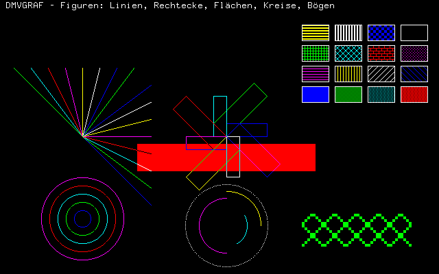
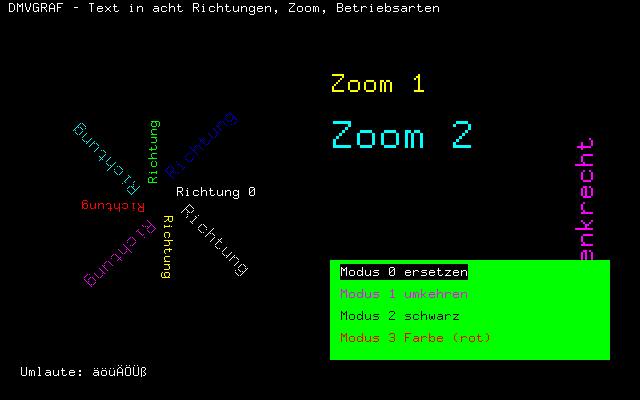
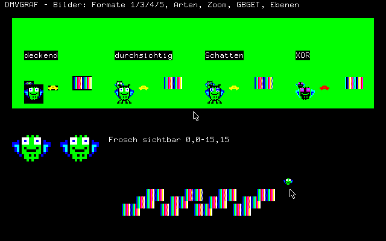

# DMVGRAF

*Deutsch weiter unten.*

## English

A graphics, image, mouse and sound library for the **NCR Decision Mate V**, linked into the program like NCRGRAF (CP/M-80, MS-BASIC) and TurboGraf (Turbo Pascal 3). It uses the same names and parameters wherever NCRGRAF or TurboGraf already had a function, so old programs carry over. It is K&R C for **CP/M-8000** (K238 Z8001 card, with a Z8000 assembler kernel) **CP/M-68K** (K234 68008 card, compiled with gcc, also on NCR's own CP/M-68K 1.2 without the DMV BIOS block) and **MS-DOS** (8088/V20, compiled with gcc-ia16), with a simulation for the PC. Ready-made libraries for all three are in [`lib/`](lib/); [`EINBINDEN.md`](EINBINDEN.md) explains how to call them from C and assembler. A Turbo Pascal 3 version follows.

- Lines, rectangles, filled boxes with 16 patterns, circles and arcs drawn by the µPD7220 itself, in eight colours and four drawing modes
- Text with the 8 × 16 font from HOPPLER (with German umlauts), in eight directions, zoom 1–16
- Images in five formats (1 bit, 4-bit colour numbers as in Nels Anderson's TIL tile sets, DMV planes, SET/RESET sprites as in HOPPLER), stored outside the program in the free segments of the K208 (BIOS 72)
- Overlapping images composed off-screen and written in one go (`GLAYER`, `GLPUT`, `GLDRAW`), with a shaded variant for selections
- Mouse pointer with saved background (`GZEIG`): moving it reads and writes only the small box around old and new position
- Mouse (K806), keyboard, frame wait, tone via the keyboard 8741

Status 0.2: CP/M-8000 tested in MAME with Mahjongg (rfka01/dmv_games). CP/M-68K in a test bench (`tools/pruef68.py`, 68000 in Unicorn): the same screens as the PC simulation, with and without the BIOS block, colour and mono; in MAME Mahjongg and MTEST start under both CP/M-68Ks, the mouse in Mahjongg is still to be confirmed. MS-DOS (new) so far only in its test bench (`tools/pruefdos.py`, 8086 in Unicorn): the same screens as the PC simulation, colour and mono.

## Deutsch

Eine Bibliothek für Grafik, Bilder, Maus und Klang auf der **NCR Decision Mate V**, die ins Programm gebunden wird – wie NCRGRAF (CP/M-80, MS-BASIC) und TurboGraf (Turbo Pascal 3). Was es dort schon gibt, heißt und verhält sich wie dort; so laufen alte Programme mit wenig Aufwand weiter. Sie ist K&R-C für **CP/M-8000** (Z8001-Karte K238, mit einem Kern in Z8000-Assembler) **CP/M-68K** (68008-Karte K234, mit gcc übersetzt, auch auf NCRs eigenem CP/M-68K 1.2 ohne DMV-BIOS-Block) und **MS-DOS** (8088/V20, mit gcc-ia16 übersetzt), dazu eine Simulation für den PC. Fertig übersetzte Bibliotheken für alle drei liegen in [`lib/`](lib/); wie man sie aus C und Assembler aufruft, steht in [`EINBINDEN.md`](EINBINDEN.md). Turbo Pascal 3 folgt.

**Stand 0.2** (30.10.2026): CP/M-8000 mit Mahjongg (rfka01/dmv_games) in MAME getestet, direkt am 7220 und über BIOS 66/67; der Z8000-Kern erzeugt dieselben GDC-Listen wie die C-Fassung. CP/M-68K im Prüfstand (`tools/pruef68.py`, 68000 in Unicorn): dieselben Bilder wie die PC-Simulation, mit und ohne BIOS-Block, Farbe und mono. In MAME starten Mahjongg und MTEST unter beiden CP/M-68K, MTEST erkennt die Maus; die Maus in Mahjongg ist noch zu bestätigen. MS-DOS (neu) bisher nur im Prüfstand (`tools/pruefdos.py`, 8086 in Unicorn): dieselben Bilder wie die PC-Simulation, Farbe und mono; MTEST erkennt Farbe und Maus.

*Bilder aus der PC-Simulation (`test/GTEST.C`).*

### Voraussetzungen unter CP/M-8000

- CP/M-8000 mit dem DMV-BIOS-Block (Funktionen 64–69, `docs/DMV-Schnittstellen.md` in rfka01/dmv_os, Abschnitt 9).
- Für Bilder: **BIOS 72** (freie Segmente, ab CP/M-8000 v015) und eine K208 (512 KB, Segmente 4–6). Ohne sie gibt `GBDEF`/`GBLOAD` den Fehler 91 (kein Bildspeicher); Programme, die nur zeichnen, laufen trotzdem. Wer keine K208 hat, bindet statt `GHSEG.C` die Datei `GHPOOL.C` (Bildspeicher als Feld im Programm, Größe dort einstellen).

### Voraussetzungen unter CP/M-68K

- 68008-Karte K234 (die Anschlüsse liegen beim 68008 auf FFF00h + Port), 256 KB reichen.
- Mit DMV-BIOS-Block (unser CP/M-68K, sobald es 64–69 hat): Maus und Ton über den BIOS, der 7220 direkt (Rückfall `gdirekt(0)`: BIOS 66/67).
- Ohne Block (NCRs CP/M-68K 1.2, unser CP/M-68K bis v003): DMVGRAF macht alles selbst wie der BIOS unter CP/M-8000 – Grafikbetrieb ein und aus (danach löscht die Konsole mit ^Z den Schirm), Farbe erkennt es an der Spiegelung des Bildspeichers der Monochromkarte, die K806 auf 30h wie MSPROBE, Ton über den 8741 wie BIOS 69. Die Tastatur bleibt bei BDOS 6.
- Auf die Anschlüsse geht DMVGRAF im Supervisorzustand (BDOS 62, `GSUP68.S`), weil nicht gemessen ist, ob die K234 sie im Benutzerzustand durchlässt.
- Bildspeicher: `GHPOOL.C` mit `-DGBPOOL=61440` (60 KB im Programm).

### Voraussetzungen unter MS-DOS

- 8088/V20 der K230/K231/K235, DOS ab 2.11. Das Programm spricht 7220 (A0h–A2h), K806 (30h) und den Tastatur-8741 (40h/41h) selbst an, mit denselben Abläufen wie unter NCRs CP/M-68K; Grafik ein und aus wie NCRs GRAPH-Bibliothek unter DOS (danach löscht die Konsole mit ^Z den Schirm). Tastatur, Text und Dateien über INT 21h.
- Speichermodell small (64 KB Code, 64 KB Daten und Stapel); Bilder in Speicherblöcken von DOS (INT 21h/48h, bis zu zwei zu 64 KB).

### Dateien

| Datei | Inhalt |
|---|---|
| `src/DMVGRAF.H` | Schnittstelle für Programme |
| `src/GRAF.C` | Zustand, GDC-Liste, Figuren, Text |
| `src/GBILD.C` | Bilder und Zusammensetzen |
| `src/GEIN.C` | Maus, Tastatur, Zeit, Auskunft, Ton |
| `src/GKERN.C` | Kern in C (Simulation, CP/M-68K) |
| `src/GZ8K.8KN` | derselbe Kern in Z8000-Assembler (CP/M-8000) |
| `src/GHWCPM.C` | Hardwareschicht CP/M-8000/CP/M-68K: BIOS-Block über BDOS 50, Tastatur über BDOS 6, Dateien über FCB |
| `src/GHSEG.C`, `src/GSC1.8KN` | Bildspeicher in freien Segmenten (BIOS 72), Kopie über DRs System Call 1 |
| `src/GHPOOL.C` | Bildspeicher als Feld im Programm |
| `src/GHDIR.C`, `src/GDIR.8KN` | CP/M-8000: GDC-Listen direkt an den 7220 (Systemmodus über BDOS 62, zurück mit `LDCTL FCW`) |
| `src/GHD68K.C`, `src/GSUP68.S` | CP/M-68K: 7220 direkt, ohne BIOS-Block auch Grafikbetrieb, Farbe, K806 und Ton; Supervisorzustand über BDOS 62 |
| `src/GCRT68.S`, `src/GARG68.C` | CP/M-68K: Startstück, BDOS-Aufruf, Kommandozeile, 32-Bit-Rechnen (statt libgcc, die 68020-Befehle enthält) |
| `src/GHWDOS.C`, `src/GCRTDOS.S` | MS-DOS: Hardwareschicht (7220, K806, 8741 direkt, Tastatur/Text/Dateien über INT 21h, Bildspeicher von DOS); Startstück, Anschlüsse, Kopieren in fremde Segmente, GDC-Liste |
| `src/GHDNUL.C` | andere Systeme: kein direkter Weg, alles über BIOS 66/67 |
| `src/GHWSIM.C` | Hardwareschicht für die Simulation am PC |
| `src/GINTERN.H`, `src/GFONT.H` | intern; Schrift aus HOPPLER (`tools/mkfont.py`) |
| `test/GTEST.C` | Prüf- und Vorführprogramm (drei Bilder, danach Mauszeiger) |
| `tools/bau68.py`, `tools/elf2cpm.py` | CP/M-68K: mit `m68k-linux-gnu-gcc` übersetzen, `.68K` erzeugen (`elf2cpm.py` aus rfka01/dmv_os, um `.rodata` erweitert) |
| `tools/pruef68.py`, `tools/simlib.c` | Prüfstand für `.68K`-Programme (Unicorn, GDC-Nachbildung aus `GHWSIM.C`) |
| `tools/baudos.py`, `tools/pruefdos.py` | MS-DOS: mit gcc-ia16 übersetzen und EXE schreiben; Prüfstand (8086 in Unicorn, nachgebildetes INT 21h) |
| `lib/` | fertige Bibliotheken für MS-DOS, CP/M-68K und CP/M-8000 (`lib/README.md`) |
| `EINBINDEN.md`, `beispiele/` | Aufruf aus C und Assembler je System, Aufrufkonventionen, was für andere Sprachen gilt; dasselbe kleine Programm in C, NASM, GNU as (68000) und asz8k |

### Übersetzen

Unter CP/M-8000 mit DRs `zcc`, `asz8k` und `ld8k` (Quellen, `STARTUP.O` und `LIBCPM.A` auf einer Diskette): `SUBMIT GTEST` (`test/GTEST.SUB`) baut `GTEST.Z8K`. Ein eigenes Programm bindet `GRAF.O GBILD.O GEIN.O GHWCPM.O GHSEG.O GHDIR.O GDIR.O GSC1.O GZ8K.O` dazu; wer keine Bilder braucht, lässt `GBILD.O` weg, sofern er keine Bildfunktion aufruft.

Unter CP/M-68K: am PC mit `gcc-m68k-linux-gnu` und `binutils-m68k-linux-gnu` `make GTEST.68K` (`make MTEST.68K` für den Maustest); ein eigenes Programm übersetzt `tools/bau68.py` (`GCRT68.S` zuerst, dann Programm, `GRAF.C GBILD.C GEIN.C GKERN.C GHWCPM.C GHD68K.C GHPOOL.C GSUP68.S GARG68.C`). Prüfstand: `make simlib.so`, dann `python3 tools/pruef68.py GTEST.68K test/GTEST.TXT [--block] [--mono]`.

Unter MS-DOS: am PC mit gcc-ia16 (`ia16-elf-gcc` in `/opt/ia16/bin`, sonst `IA16=…`) `make GTEST.EXE` und `make MTEST.EXE`; ein eigenes Programm wie in `lib/README.md`. Prüfstand: `make simlib.so`, dann `python3 tools/pruefdos.py GTEST.EXE test/GTEST.TXT [--mono]`.

Fertige Bibliotheken: `make lib` (MS-DOS und CP/M-68K), Gebrauch in `lib/README.md`.

Simulation am PC: `make gtest`, dann `GSKRIPT=test/GTEST.TXT ./gtest`. Die Simulation führt die GDC-Listen so aus wie der µPD7220 im Mischbetrieb (nach MAMEs `upd7220.cpp`) und schreibt auf Befehl Bildschirmabzüge (PPM). Skriptzeilen: `maus x y knopf` (Bildzeilen von oben), `taste c` oder `taste 0xNN`, `bild datei.ppm`. Umgebung: `GMONO=1` monochrom, `GMAUS=0` ohne Maus, `GPROT=1` jeden GDC-Befehl melden, `GSUMME=1` Prüfsumme der Listen.

### Grundsätze

- **Koordinaten wie NCRGRAF:** x 0–639 nach rechts, y 0–399 nach **oben**, (0,0) links unten. `GORIG(1)` lässt y von oben zählen.
- **Ein Zeichenpunkt** (`GPOINT`): Linien, Rechtecke, Flächen, Text und Bilder beginnen dort. Figuren erstrecken sich vom Zeichenpunkt in Richtung +x und +y: bei y nach oben ist der Zeichenpunkt die linke untere Ecke, bei `GORIG(1)` die linke obere.
- **Farbe** 0–7 (1 blau, 2 grün, 4 rot) wie TurboGraf; auf der Mono-DMV gilt jede Farbe außer 0 als hell.
- **Richtungen** 0–7 in 45°-Schritten gegen den Uhrzeiger (bei y nach unten gespiegelt).
- Alle Funktionen liefern `int`: 0 gut, sonst ein Fehlercode (1–83 wie NCRGRAF).
- Externe Namen höchstens 6 Zeichen (DRs Binder unter CP/M-8000).

### Funktionen wie NCRGRAF / TurboGraf

| Name | Parameter | Wirkung |
|---|---|---|
| `ginit` | – | Grafik ein, Schirm leer; Muster 0, Zoom 0, Modus 1, Farbe 7 |
| `gexit` | – | zurück in den Textbetrieb |
| `gpoint` | x, y | Zeichenpunkt setzen |
| `gline` | x, y | Linie vom Zeichenpunkt nach (x,y); danach steht der Zeichenpunkt dort |
| `gcircl` | r | Kreis um den Zeichenpunkt |
| `garc` | r, anf, ende | Bogen von `anf` bis `ende` Grad (0° = rechts, gegen den Uhrzeiger) |
| `grect` | m, n, d | Rechteck m × n in Richtung d |
| `gbox` | m, n, d | gefülltes Rechteck mit dem Muster, Größe × (Zoom + 1) |
| `gtext` | s, d | Text in Richtung d; Feld 8·(Z+1) × 16·(Z+1); der Zeichenpunkt rückt hinter den Text |
| `gmode` | m | 0 ersetzen (Hintergrund von Text und Muster schwarz), 1 umkehren (XOR), 2 schwarz zeichnen, 3 in der Farbe zeichnen |
| `gpatt` | p | Füll- und Linienmuster 0–15 (die ersten zwei Musterzeilen sind das Linienmuster) |
| `gzoom` | z | Zoom 0–15 für Text, Flächen und Bilder |
| `gcolor` | c | Farbe 0–7 |
| `gclear` | – | Schirm leer, Grafik bleibt an |
| `where` | &x, &y | Zeichenpunkt lesen |
| `gorig` | o | 0 y nach oben (Vorgabe), 1 y nach unten |

Muster: 0 voll, 1 50 %, 2 25 %, 3 75 %, 4 waagrechte Linien, 5 senkrechte, 6 `/`, 7 `\`, 8 Gitter, 9 Kreuz, 10 Ziegel, 11 12,5 %, 12 breite waagrechte, 13 breite senkrechte, 14 großes Brett, 15 leer.

`gmode` folgt NCRGRAF (Vorgabe nach `ginit`: 1 umkehren). Text in Richtung 0 geht wortweise (schnell, Zoom in Software), in den anderen Richtungen als Grafikzeichen des 7220.

### Bilder

| Name | Parameter | Wirkung |
|---|---|---|
| `gbdef` | nr, b, h, format, daten | Bild nr (0–63) aus dem Programmspeicher anlegen |
| `gbload` | nr0, datei, b, h, anz, format, kopf | `anz` Bilder b × h aus einer Datei ab nr0 anlegen; vorher `kopf` Byte überspringen |
| `gbmap` | farbe, a, b, muster | Farbnummer 0–15 (Format 3) als DMV-Farbe a oder als Raster aus a und b |
| `gbput` | nr, art | Bild am Zeichenpunkt zeichnen, mit Zoom |
| `gbget` | nr, b, h | Schirmausschnitt am Zeichenpunkt als Bild ablegen |
| `gbfree` | nr | Bild freigeben (der Speicher dahinter rückt nach) |
| `gbinfo` | nr, int r[6] | Breite, Höhe und sichtbarer Bereich x0, y0, x1, y1 (Bildpunkte, y von oben) |

**Formate:**

| | Inhalt | Beispiel |
|---|---|---|
| 1 `GB_BIT7` | 1 Bit je Punkt, Bit 7 links, je Zeile (b+7)/8 Byte | DMVRACE-Wagen |
| 2 `GB_BIT0` | 1 Bit je Punkt, Bit 0 links | eigene Schrift, Masken |
| 3 `GB_NIB` | 4 Bit je Punkt (Farbnummer 0–15), hohes Halbbyte links | TIL-Steinsätze, EGA-Rohdaten |
| 4 `GB_EBN` | je Zeile Maske, Grün, Rot, Blau, Bit 0 links | Zeiger, interne Form |
| 5 `GB_SETR` | `int`-Worte: je Ebene (Grün, Rot, Blau) SET-, dann RESET-Worte aller Zeilen, Bit 0 links | HOPPLER-Figuren (`Spr16`); nur `gbdef` |

- 1-Bit-Bilder zeichnen in der aktuellen Farbe.
- **Format 3:** `gbmap` setzt jede Farbnummer auf eine DMV-Farbe a, oder mit `muster` 1 (Schachbrett), 2 (jeder vierte Punkt) oder 3 (jede zweite Zeile) auf ein Raster aus a und b. **a = −1 macht die Farbnummer durchsichtig;** `muster` sagt dann, wie die Form entsteht: 0 jeder Punkt für sich, 1 je Zeile vom ersten bis zum letzten sichtbaren Punkt gefüllt (Lücken in Farbe b), 2 wie 1, um einen Punkt nach allen Seiten erweitert (Rand in Farbe b). Vorgabe wie Mahjongg: 0 durchsichtig, Hellgrau → Weiß, Dunkelgrau → Raster Schwarz/Blau, Braun → Raster Gelb/Rot, die übrigen auf die nächste DMV-Farbe; mono: Hellgrau und Weiß hell, Dunkelgrau im Raster, alles andere dunkel. Eine TIL-Datei ist `gbload(0, "X.TIL", 40, 40, 42, GB_NIB, 0)`.
- **Arten** für `gbput` und `glput`: 0 `GB_DECK` deckend (das ganze Rechteck), 1 `GB_DURCH` durchsichtig, 2 `GB_SCHAT` durchsichtig und schattiert (Weißes im Raster Weiß/Blau, mono Helles im 50-%-Raster – für Auswahlen), 3 `GB_XOR` umkehren.
- `gbput` zeichnet wortweise über Setzen und Löschen je Ebene; Nachbarpunkte bleiben unberührt. Bilder werden am Schirmrand abgeschnitten.
- `gbget` liest mit RDAT über BIOS 67. MAMEs 7220 liefert dabei genau DC Worte, der echte DC+1; DMVGRAF fordert DC = Zahl der Worte an und liest so viele.

### Zusammensetzen

| Name | Parameter | Wirkung |
|---|---|---|
| `glayer` | x0, y0, x1, y1 | Ausschnitt beginnen (Ecken einschließlich) |
| `glput` | nr, x, y, art | Bild eintragen, von hinten nach vorn; Bilder außerhalb fallen weg |
| `gldraw` | – | Ausschnitt im Speicher zusammensetzen und ersetzend zeichnen |

Für Brettspiele und alles, wo sich Bilder überdecken: nichts flackert, und jeder Punkt geht nur einmal zum 7220. Der Ausschnitt wird waagrecht auf ganze Worte (16 Punkte) erweitert; der Hintergrund ist schwarz. Bis zu 200 Einträge; `glput` kennt keinen Zoom.

### Maus, Tastatur, Zeit, Auskunft, Ton

| Name | Parameter | Wirkung |
|---|---|---|
| `ginfo` | &farbe, &maus, &syn, &covox | Farb-/Mono-DMV, K806, Synthesizer-Firmware, Covox (die letzten beiden noch immer 0) |
| `mpos` | &x, &y, &k | Mausposition in den gewählten Koordinaten, Knöpfe (Bit 0 links, 1 rechts, 2 Mitte); 1 gelesen |
| `mset` | x, y | Mausposition setzen (K806 Befehl 04h) |
| `gzeig` | nr, x, y | Mauszeiger: Bild nr (höchstens 32 × 32 Punkte) durchsichtig an x, y; DMVGRAF sichert den Hintergrund (aus dem Bildspeicher gelesen) und stellt ihn beim Versetzen wieder her. Andere Ausgaben nehmen den Zeiger vorher weg, `mpos`, `gkey` und `gwait` zeigen ihn wieder. nr < 0 nimmt ihn weg |
| `gdirekt` | an | GDC-Listen direkt an den 7220 (1, Vorgabe unter CP/M-8000) oder über BIOS 66/67 (0); Ergebnis: vorherige Einstellung, −1 wenn es keinen direkten Weg gibt |
| `gkey` | – | Taste oder 0, wartet nicht |
| `gwait` | n | n Bildwechsel abwarten |
| `grnd` | – | Zufallszahl 0–32767 für den Start (aus der Lage des Bildaufbaus und der Maus) |
| `ton` | h, l | Ton h (1–42 Halbtöne ab 110 Hz, 0 Pause), l × 20 ms, über den Tastatur-8741; wartet nicht, 1 = der 8741 spielt noch |
| `gputs` | s | Text auf die Konsole (im Textbetrieb) |

`gkey`, `grnd` und `gputs` sind neu gegenüber NCRGRAF (BASIC hatte `INKEY$` und `PRINT`).

### Geplant

- **`gprint`** (p, l): Bildschirm drucken wie NCRGRAF, mit den Druckerarten von DMVSNAP (0 Epson FX, 1 IBM Proprinter, 2 HP PCL).
- **Synthesizer:** `synavl`, `synon`, `synoff`, `synfrq`, `syninc`, `synnoi`, `synclk` (Namen wie `DMVSYN.INC` aus DMVTRAK). Die Synthesizer-Firmware für den Tastatur-8741 (`dmv_mb_8741_32678_synth.bin`, rfka01/dmv_firmware) ist **keine NCR-Firmware, sondern ein Eigenbau** auf Grundlage des Original-ROM 32678, und sie ist **optional**: in MAME eine eigene BIOS-Auswahl, auf einer echten DMV ein neu gebranntes 8741. DMVGRAF erkennt sie und fällt ohne sie auf `ton` zurück. Unter CP/M laufen die Aufrufe über BIOS 73.
- **Covox** am Druckerausgang K210: `smplay`, `smstop` (unter MS-DOS mit K235 im Hintergrund, unter CP/M-8000 nur blockierend).
- Fassungen für CP/M-68K, MS-DOS und Turbo Pascal 3.

### Hardware

Tastatur und Ton (8741) und Maus (K806) laufen über den DMV-BIOS-Block, wo es ihn gibt (ohne ihn, unter NCRs CP/M-68K, spricht `GHD68K.C` sie selbst an, mit denselben Abläufen wie der BIOS); der 7220 gehört im Grafikbetrieb dem Programm (`docs/DMV-Schnittstellen.md`, Abschnitt 9, „Wem welche Hardware gehört“). Diese Fassung baut alles als GDC-Befehlsliste (Aufbau wie BIOS 66) und gibt sie selbst an den 7220 aus (CP/M-8000 `GDIR.8KN`, CP/M-68K `GHD68K.C`: BDOS 62 holt den System- bzw. Supervisorzustand, vor jedem Byte wird gewartet, bis das FIFO nicht voll ist, wie im BIOS); `gdirekt(0)` schaltet auf BIOS 66/67 um. Unter CP/M-8000 sind beide Wege mit Mahjongg in MAME getestet. Gezeichnet wird wie in HOPPLERs `DMVGFX.INC` und DMVDEMOs `GDCLIB.INC`: Mischbetrieb, 40 Worte je Bildzeile, Bit 0 = linker Punkt, GD-Bit für alles, was senkrecht weiterschreitet, nach jedem CURS eine neue MASK, vor Wortfolgen FIGS mit DC = 0 (der 7220 schreibt das erste Wort nach WDAT DC+1-mal).

### Lizenz

MIT, siehe [`../LICENSE`](../LICENSE). Code: Claude (Anthropic) · Idee und Prompts: rfka01
